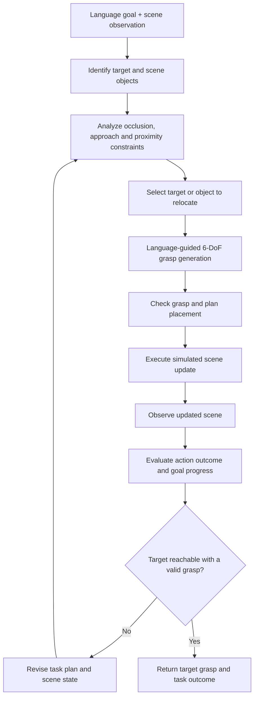

# Closed-Loop Multi-Agent Planning for Robotic Decluttering

**A closed-loop, multi-agent framework for robotic scene decluttering that continuously evaluates task progress and replans using execution feedback.**

## Overview

A robot asked to retrieve an object from a cluttered scene may need to move other objects before the target becomes graspable. A single grasp prediction or an open-loop sequence of actions cannot reliably handle changing visibility, obstructed approaches, or unexpected execution outcomes.

This project develops a **closed-loop planning and grasping pipeline** that repeatedly observes the scene, identifies obstructions, selects objects to relocate, generates grasps and placements, evaluates the outcome, and updates its plan. It combines a task-level decluttering loop with language-guided, six-degree-of-freedom grasp generation. The implementation builds on [GraspMAS](https://github.com/Fsoft-AIC/GraspMAS) and integrates [GraspGen-X](https://github.com/NVlabs/GraspGenX).

Motivated by the challenges of **long-horizon robotic autonomy**, the system maintains task context across successive actions and revises its decisions when execution outcomes differ from expectations.

## System architecture



The system separates two levels of reasoning:

- **Task-level planning:** determines which object to pursue or move, maintains object identities and the task goal, and revises decisions after each action.
- **Grasp-level reasoning:** uses the Planner–Coder–Observer loop inherited from GraspMAS to generate and assess language-conditioned grasps, with GraspGen-X supplying 6-DoF grasp candidates.

## Implementation

### Closed-loop task planning

- **Scene understanding:** tracks objects across observations and analyzes blockers using occlusion, grasp-approach constraints, and object proximity.
- **Goal and target selection:** interprets a language goal and can rank candidate objects when the target is not explicitly specified.
- **Placement selection:** searches for relocation poses that preserve clearance and avoid placing an obstruction back in front of the target.
- **Execution feedback:** distinguishes whether an action executed as intended from whether it made progress toward the goal. Failed or unhelpful actions can trigger a revised plan rather than a fixed retry sequence.
- **Persistent task state:** records decisions, execution reports, and plan revisions so an interrupted run can be inspected or resumed.

### Language-guided 6-DoF grasping

The grasping pipeline replaces the original image-plane grasp output with an **SE(3) grasp pose**. Object- or part-level segmentation is combined with sensor depth (or a monocular-depth fallback) to form a point cloud for GraspGen-X. Candidate grasps are filtered and assessed using the target geometry, gripper configuration, and surrounding scene.

The implementation includes a CPU-oriented inference path and a client–server interface that avoids reloading the grasp-generation model on every request.

## Evaluation

The code includes offline tests, RGB-D grasp-generation checks, and a task-level decluttering evaluation in **synthetic scenes using scene-state updates rather than physics-based object manipulation**.

| Evaluation | Documented observation |
|---|---|
| Blocked-target decluttering | A target initially 32% visible became fully visible after relocating two blocking objects in a three-iteration synthetic-scene run. |
| Failure-aware replanning | Drop and wrong-object failures prompted recovery; offset and collateral effects were reported, while tipping exposed a limitation of geometry-only evaluation. |
| 6-DoF grasp pipeline | Tested object/part grounding, grasp-pose generation, and different gripper configurations on sample RGB-D observations. |

The repository documents additional runs with a live language model in the planning loop. These experiments exercise decision-making, state updates, and recovery from **injected** failures; they do not establish real-robot grasp or pick-and-place success.

For methodology and test details, see [decluttering system documentation](docs/declutter.md) and the [technical evaluation notes](SUMMARY.md).

## Repository organization

| Location | Contents |
|---|---|
| [`GraspMAS/declutter.py`](GraspMAS/declutter.py) | Outer planning–execution–evaluation loop |
| [`GraspMAS/agents/task_planner.py`](GraspMAS/agents/task_planner.py) | Goal interpretation and task-level decisions |
| [`GraspMAS/scene_registry.py`](GraspMAS/scene_registry.py) | Object identities, scene state, and blocking analysis |
| [`GraspMAS/placement.py`](GraspMAS/placement.py) | Placement and clearance planning |
| [`GraspMAS/evaluator.py`](GraspMAS/evaluator.py) | Action-outcome and task-progress evaluation |
| [`GraspMAS/execution/`](GraspMAS/execution/) | Scene-mutation executor and robot-executor interface |
| [`GraspMAS/perception3d.py`](GraspMAS/perception3d.py) | RGB-D geometry and 6-DoF grasp representations |
| [`GraspMAS/graspgen/client.py`](GraspMAS/graspgen/client.py) | GraspGen-X integration |
| [`GraspMAS/tests/`](GraspMAS/tests/) | Unit and integration-style tests |
| [`scripts/`](scripts/) | Verification, setup, and experiment utilities |

The `GraspMAS/` and `GraspGenX/` directories also contain upstream project code; the table highlights the components most relevant to this integration.

## Running the synthetic decluttering example

After installing the project dependencies (see [`scripts/setup.sh`](scripts/setup.sh); it downloads several gigabytes of model assets), run the offline verification from the repository root:

```bash
conda run -n graspmas python scripts/verify_declutter.py
```

To execute the synthetic scene-update loop without an LLM service:

```bash
cd GraspMAS
python main_declutter.py --goal "pick up the banana" --target banana --no-llm
```

To exercise recovery from a one-time injected drop:

```bash
python main_declutter.py --goal "pick up the banana" --target banana --no-llm --inject drop
```

For the language-model-driven flow and grasp-generation service, consult [`docs/declutter.md`](docs/declutter.md) and the existing setup scripts. Model weights and gripper assets are external dependencies.

## Acknowledgements and third-party components

This work extends **[GraspMAS: Zero-Shot Language-driven Grasp Detection with Multi-Agent System](https://github.com/Fsoft-AIC/GraspMAS)** (Nguyen *et al.*, IROS 2025), which introduced the Planner–Coder–Observer grasp-reasoning architecture. It uses **[GraspGen-X: Cross-Embodiment 6-DOF Diffusion-based Grasping](https://github.com/NVlabs/GraspGenX)** (Han *et al.*, CVPR 2026) for grasp generation across robotic grippers.

The extensions in this repository focus on integrating 6-DoF grasp output and building the task-level decluttering, placement, scene tracking, execution evaluation, and replanning infrastructure around these existing methods. The bundled upstream components retain their original license terms; see the license files within their respective directories.
